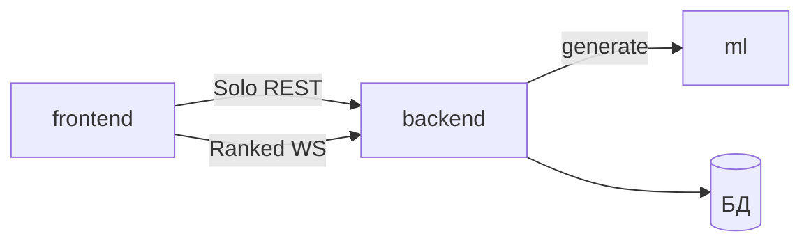
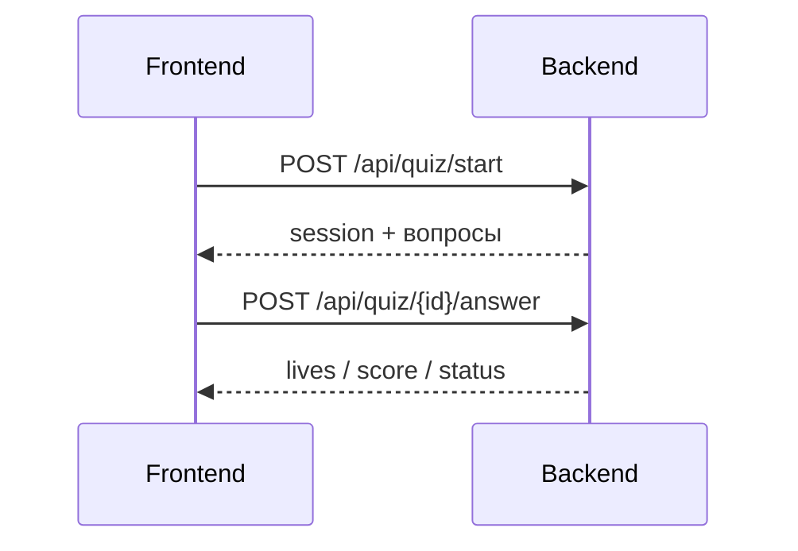
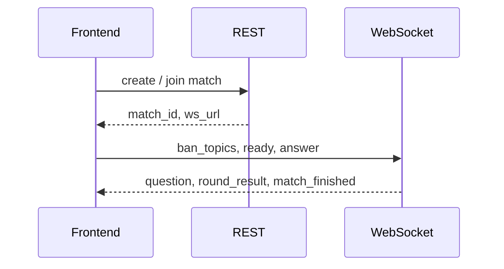
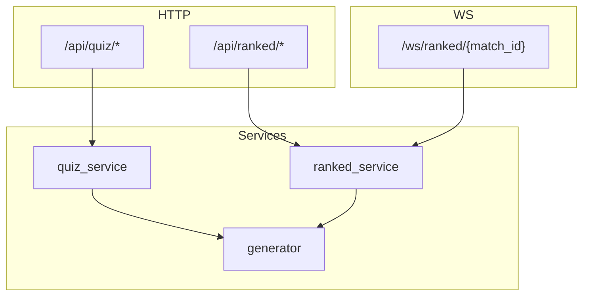

# Infinite Quiz — Backend

Монолитный API: **solo (REST)** + **ranked (REST лобби + WebSocket)**.  
Генерация вопросов: stub → ML.

Org: [infinite-quiz](https://github.com/infinite-quiz)  
Стек: **FastAPI · SQLAlchemy · Alembic · WebSocket · SQLite/Postgres**

## Архитектура



| Режим | Что использует |
|--------|----------------|
| Solo | `/api/quiz/start`, `/answer` — жизни, пачка вопросов |
| Ranked | `/api/ranked/matches` + `/ws/ranked/{id}` — 1v1, таймер, бан тем |

## Solo



## Ranked



Вопросы для ranked генерируются пачкой на сервере, клиенту уходит **только текущий**.

## Модули



## Быстрый старт

```bash
python -m venv .venv
.venv\Scripts\activate
pip install -r requirements.txt
copy .env.example .env

alembic upgrade head
uvicorn app.main:app --reload --port 8000
```

- Swagger: http://localhost:8000/docs  
- Health: http://localhost:8000/api/health  
- Ranked smoke (2 WS-клиента):

```bash
py -3 scripts/ranked_ws_smoke.py
```

## Структура

```text
app/
  api/routes/     # quiz + ranked REST
  api/ws/         # ranked WebSocket
  db/models/      # solo + ranked
  services/       # quiz_service, ranked_service, generator, ws_manager
alembic/          # миграции
docs/             # архитектура и контракты
scripts/          # smoke-тесты
```

## Документация

- [Обзор (презентация)](docs/system-overview.md)
- [Архитектура](docs/architecture.md)
- [API solo](docs/api.md)
- [Ranked REST + WS](docs/ws.md)
- [Схема БД](docs/database.md)
- [Ветки](docs/branches.md)

## Конфиг

| Переменная | Описание |
|------------|----------|
| `DATABASE_URL` | SQLite или Postgres |
| `CORS_ORIGINS` | origins фронта |
| `GENERATOR_MODE` | `stub` \| `http` |
| `GENERATOR_URL` | URL ML при `http` |
| `PUBLIC_WS_BASE_URL` | база для `ws_url` в ответе ranked |
| `RANKED_ROUND_SECONDS` | таймер раунда по умолчанию |

## Роли

| Роль | Зона |
|------|------|
| Backend #1 | solo + ranked game logic |
| Backend #2 | миграции, WS инфра, конфиг |
| ML | generate-контракт |
| Тимлид | docs, ревью |
