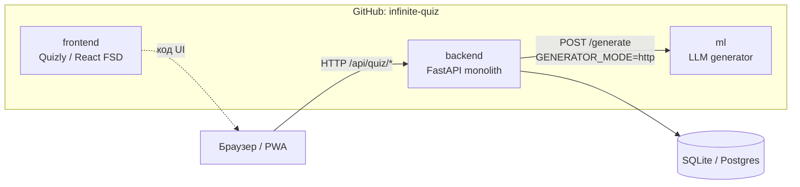
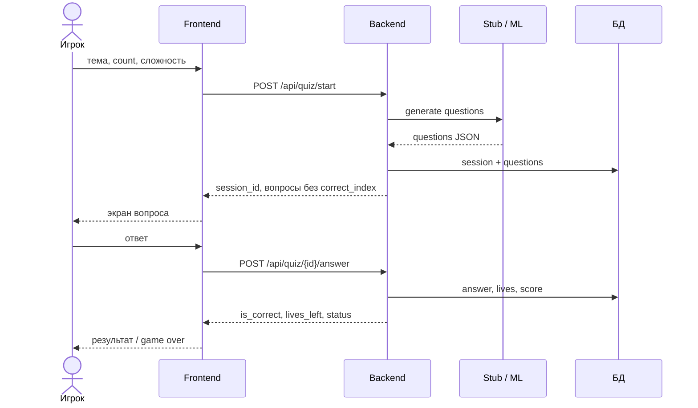
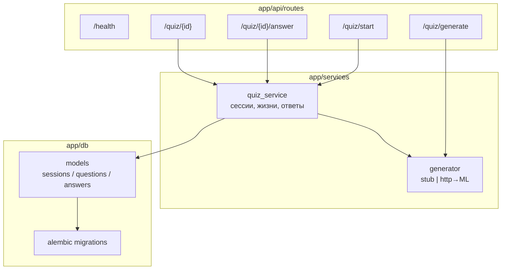

# Infinite Quiz — Backend

Монолитный API для бесконечного квиза с генерацией вопросов (stub → ML).

Org: [infinite-quiz](https://github.com/infinite-quiz)  
Стек: **FastAPI · SQLAlchemy · Alembic · SQLite/Postgres**

## Архитектура системы



## Поток игры



## Модули backend



## Быстрый старт

```bash
cd backendquiz   # или клон репозитория
python -m venv .venv
# Windows:
.venv\Scripts\activate
pip install -r requirements.txt
copy .env.example .env

alembic upgrade head
uvicorn app.main:app --reload --port 8000
```

- Docs: http://localhost:8000/docs  
- Health: http://localhost:8000/api/health  
- Generate stub: `POST http://localhost:8000/api/quiz/generate`

```bash
curl -X POST http://localhost:8000/api/quiz/generate ^
  -H "Content-Type: application/json" ^
  -d "{\"topic\":\"Космос\",\"count\":3,\"difficulty\":\"easy\"}"
```

## Структура репозитория

```text
app/
  api/routes/     # HTTP
  db/models/      # ORM
  schemas/        # Pydantic-контракты
  services/       # game + generator
alembic/          # миграции
docs/             # архитектура, API, БД, ветки
```

## Документация

- [Обзор системы (для презентации)](docs/system-overview.md)
- [Архитектура](docs/architecture.md)
- [API contract](docs/api.md)
- [Схема БД](docs/database.md)
- [Ветки](docs/branches.md)

## Конфиг

Скопируй `.env.example` → `.env`.

| Переменная | Описание |
|------------|----------|
| `DATABASE_URL` | SQLite или Postgres |
| `CORS_ORIGINS` | origins фронта |
| `GENERATOR_MODE` | `stub` или `http` |
| `GENERATOR_URL` | URL ML-сервиса при `http` |

## Роли в этом репо

| Роль | Зона |
|------|------|
| Backend #1 | `services/quiz_service`, модели, жизни |
| Backend #2 | миграции, конфиг, CORS, инфраструктура |
| ML | контракт generate; позже `GENERATOR_MODE=http` |
| Тимлид | `docs/`, ревью PR |
