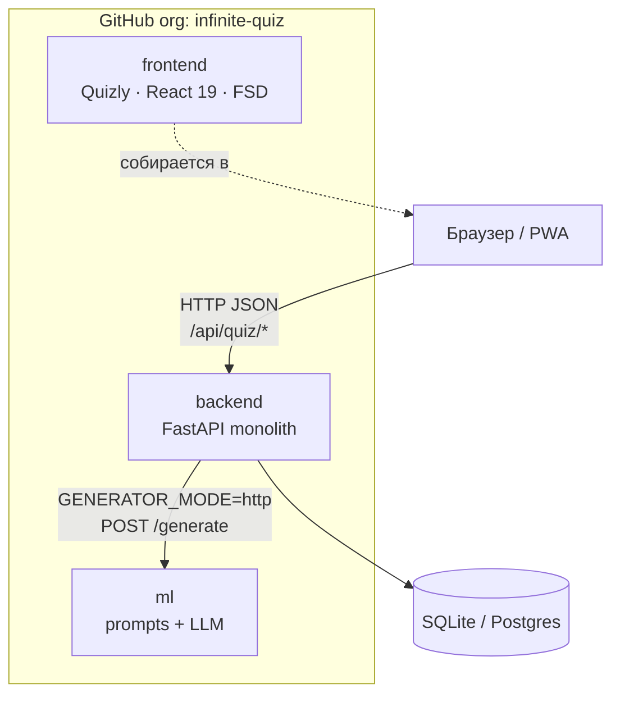
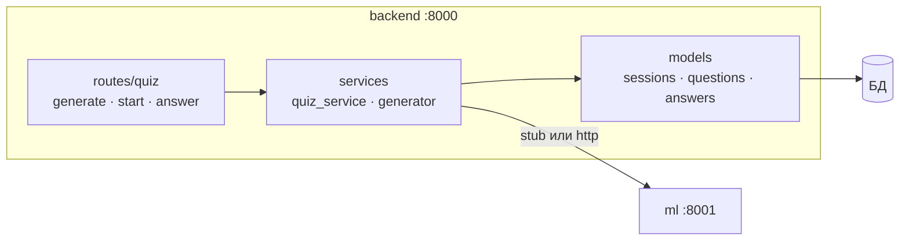
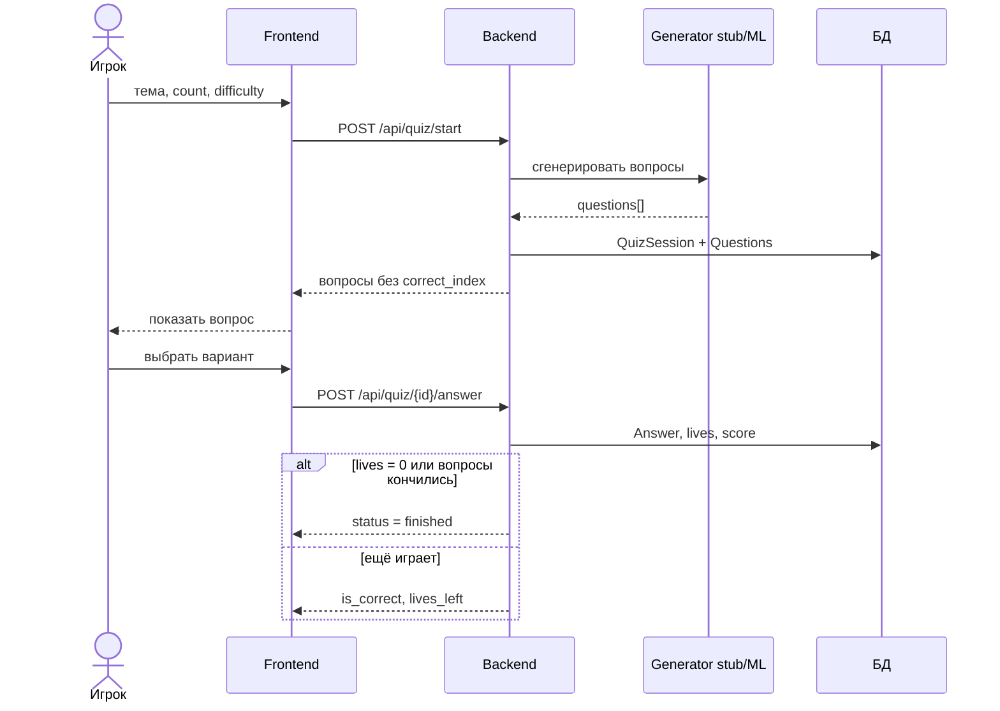
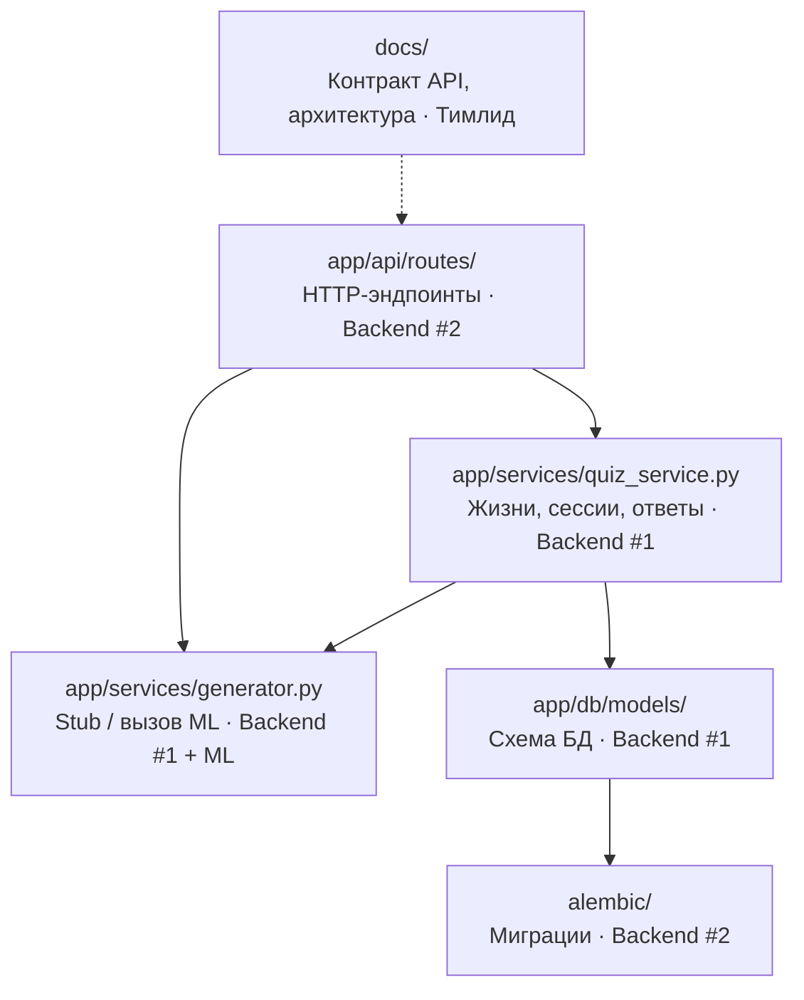
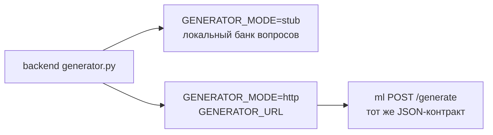

# Архитектура Infinite Quiz

Монолитный backend (FastAPI) + отдельный frontend-репозиторий + ML-сервис генерации вопросов.

## Обзор системы

## Внутренности backend

## Поток игры

## Модули backend и ответственность

## Граница с ML

- Сейчас: `GENERATOR_MODE=stub`.
- Цель: `GENERATOR_MODE=http` + сервис из репозитория `ml`.

Контракт генерации — см. [api.md](api.md).
