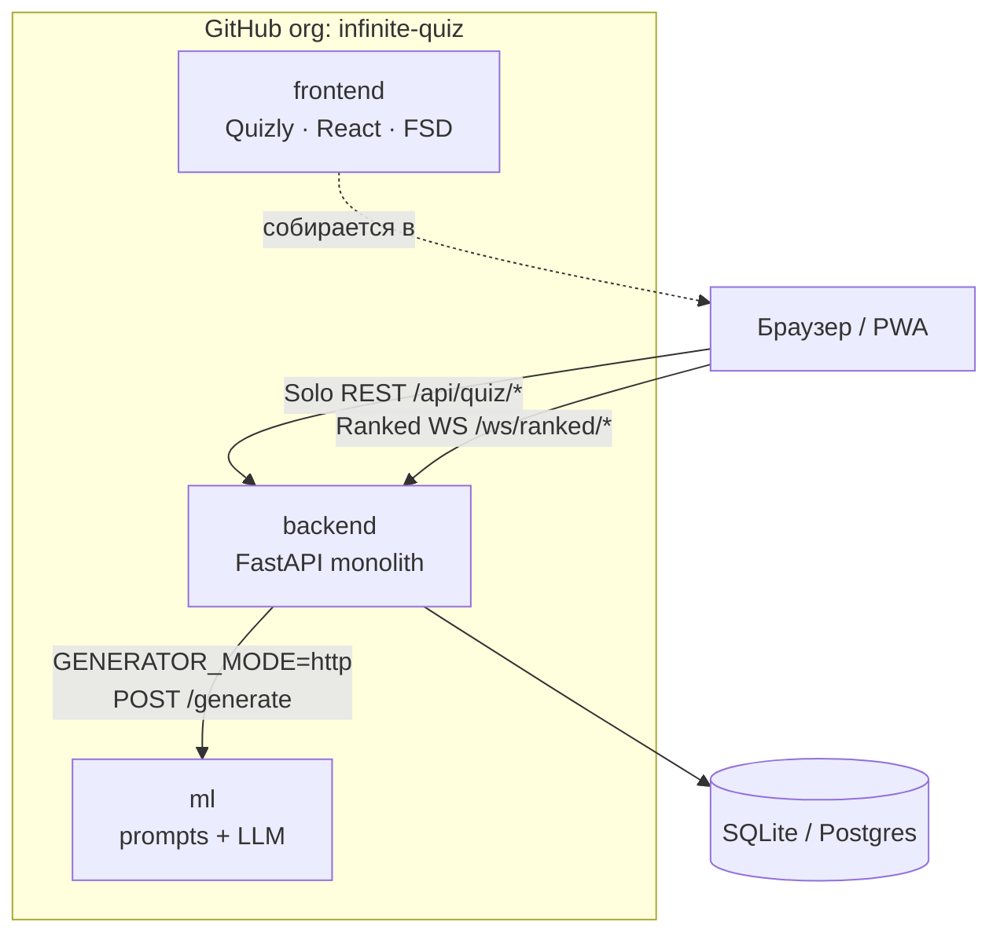
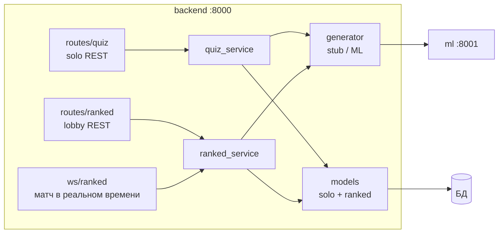
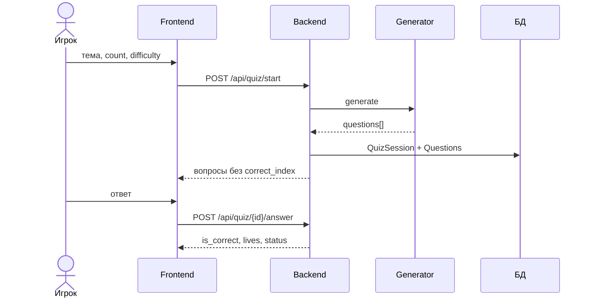
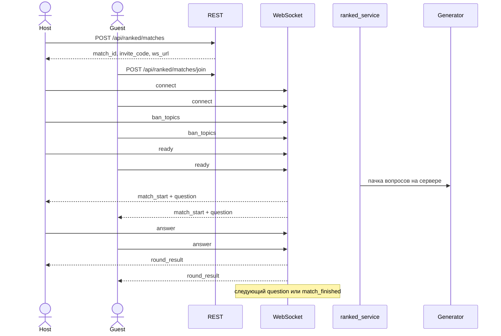
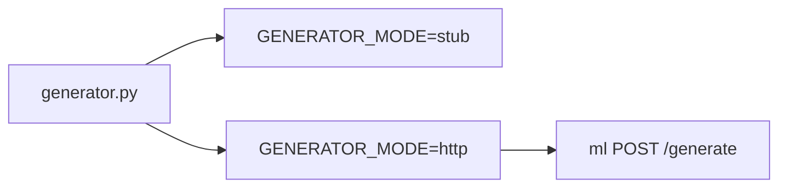

# Архитектура Infinite Quiz

Монолитный backend (FastAPI) + frontend (Quizly) + ML-генератор вопросов.

Два режима игры:

| Режим | Транспорт | Вопросы клиенту |
|--------|-----------|-----------------|
| **Solo** | REST `/api/quiz/*` | можно пачкой при `start` |
| **Ranked** | REST лобби + **WebSocket** | строго по одному вопросу |

## Обзор системы

## Внутренности backend

## Solo — поток

## Ranked — поток

Подробный контракт событий: [ws.md](ws.md).

## Модули и ответственность

| Путь | Зона |
|------|------|
| `app/api/routes/quiz.py` | Solo REST |
| `app/api/routes/ranked.py` | Ranked REST (create/join/get) |
| `app/api/ws/ranked.py` | Ranked WebSocket |
| `app/services/quiz_service.py` | Solo: жизни, ответы |
| `app/services/ranked_service.py` | Ranked: бан, раунды, таймер |
| `app/services/generator.py` | Stub / HTTP → ML |
| `app/services/ws_manager.py` | Комнаты WS по match_id |
| `app/db/models/quiz.py` | Solo-модели |
| `app/db/models/ranked.py` | Match, MatchPlayer, Round, RoundAnswer |
| `docs/` | Контракты и схемы |

## Граница с ML

- Сейчас: `stub`.
- Цель: `http` + репозиторий `ml`.
- Для ranked вопросы генерируются **пачкой на сервере**, клиенту уходит только текущий раунд.

Контракты: [api.md](api.md) (solo), [ws.md](ws.md) (ranked).
