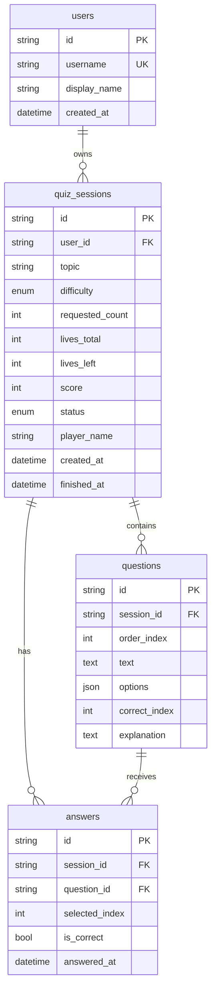
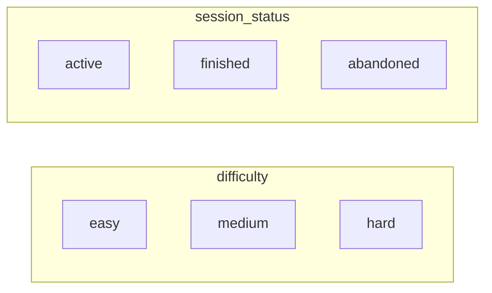

# Схема БД

## ER-диаграмма



## Enums



## Миграции

```bash
# применить
alembic upgrade head

# новая (после изменения models)
alembic revision --autogenerate -m "describe_change"
alembic upgrade head
```

Локально по умолчанию: SQLite файл `quiz.db`.  
Прод: `DATABASE_URL=postgresql+psycopg://...` в `.env`.
