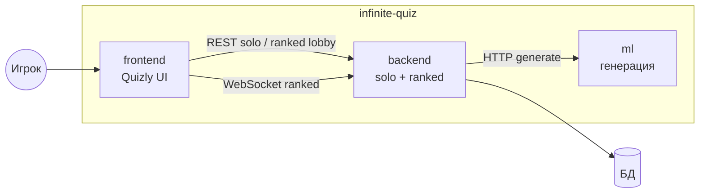
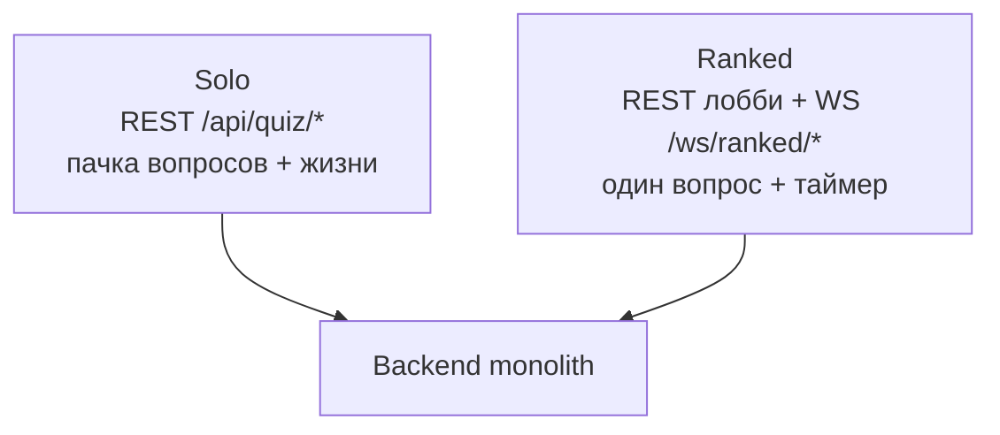
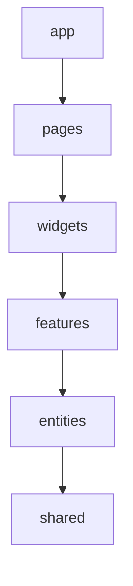
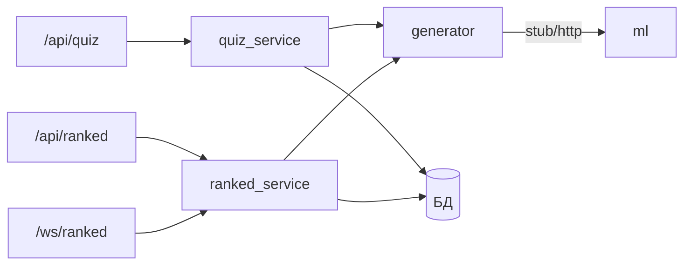

# Infinite Quiz / Quizly — обзор для презентации

Игрок выбирает тему и сложность.  
**Solo** — один игрок, REST, жизни.  
**Ranked** — 1v1, WebSocket, таймер, бан тем, один вопрос за раз.

## Три репозитория

## Два режима

## Frontend — FSD

## Backend — модули

## Ranked коротко

1. REST: создать / войти в матч → `match_id` + `ws_url`  
2. WS: ban → ready → вопросы по одному → answer → round_result → match_finished  
3. Будущие вопросы и правильный ответ до конца раунда клиенту не отдаются  

Детали: [architecture.md](architecture.md), [ws.md](ws.md), [api.md](api.md).
