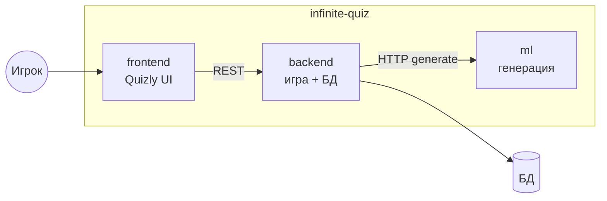
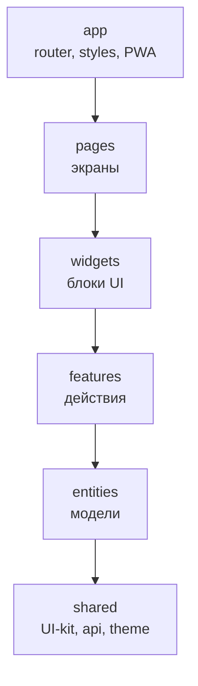
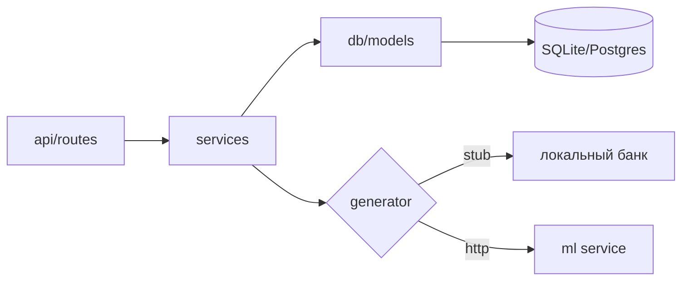
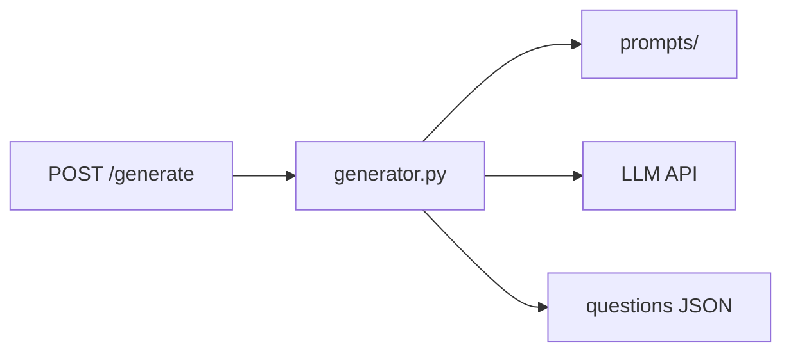
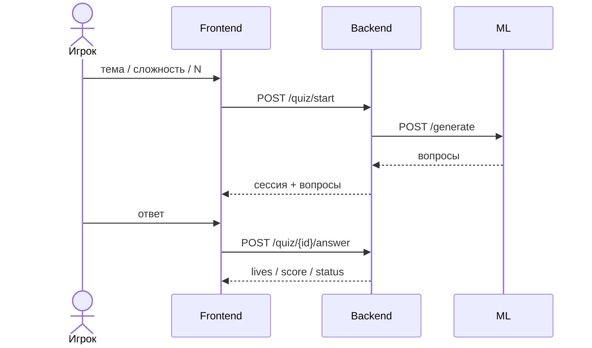

# Infinite Quiz / Quizly — обзор для презентации

Кратко: игрок задаёт тему и сложность → backend создаёт сессию с жизнями → вопросы генерирует ML → фронт показывает игру.

## Три репозитория

## Frontend — слои FSD

## Backend — монолит

## ML — генератор

## Сквозной сценарий

